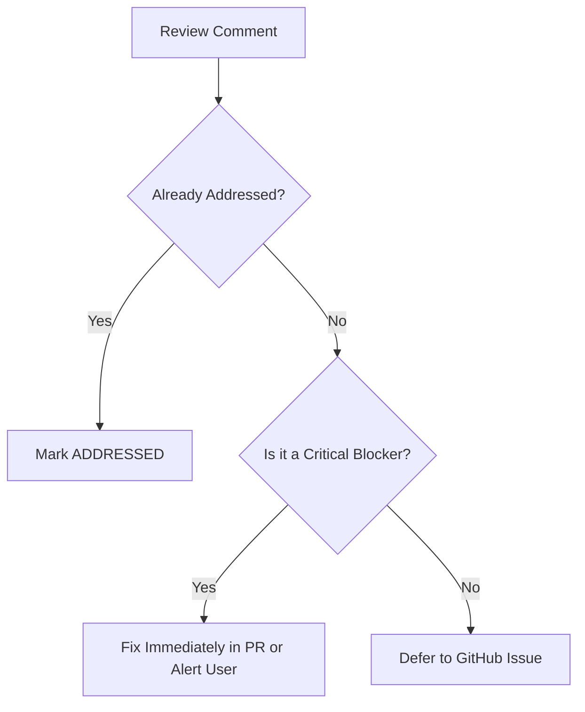

# Triage & Decision Rubric: PR Review Comments

This reference guides AI agents and developers in systematically reviewing PR comments (such as from CodeRabbit, Sonar, or peer reviewers) when preparing to merge a Pull Request.

---

## 1. Classification Decision Tree

When evaluating any review finding or inline comment, apply the following 3-tier classification:



### Tier 1: Addressed
- The comment was resolved by a subsequent commit on the branch.
- Marked by CodeRabbit as `✅ Addressed in commit ...` or manually verified in the code.
- **Action:** Record in summary table under "Addressed / Implemented".

### Tier 2: Critical Blocker (Fix Now or Alert User)
Criteria:
1. **Plaintext Secrets / API Keys**: Any exposed access tokens, secrets, or default fallback strings in code or CI workflows (strictly prohibited by project rules).
2. **Infinite Loops / Resource Exhaustion**: Player loops without stopping, unconstrained memory allocations, recursion leaks.
3. **Data Loss / State Corruption**: Unhandled exceptions breaking essential user flows (e.g., app crash on startup).
4. **Broken Builds / Failed Tests**: Unit test suite or static analysis (`flutter test`, `flutter analyze`) failing.

**Action:**
- If trivial/clear: apply minimal fix directly on the PR branch, add unit tests, and verify green.
- If architectural or ambiguous: HALT merge, summarize findings, and alert the user.

### Tier 3: Non-Critical / Technical Debt (Defer to GitHub Issue)
Criteria:
1. **Future Refactoring / Blueprints**: Architectural proposals for upcoming milestones (e.g. Appwrite, BetterFeedback).
2. **Documentation Polish**: Minor wording nuances, markdown link formatting, clarification notes in docs.
3. **Secondary Edge Cases**: Graceful fallbacks for rare third-party network outages or niche translation edge cases.
4. **Test Tooling / Harness Upgrades**: Migrating secondary drivers (e.g. Flutter Driver -> integrationDriver) where primary tests are already green.

**Action:**
- File a tracked GitHub issue on the repository using `gh issue create`.
- Record issue link and title in the summary response.

---

## 2. Pre-Merge Verification Checklist

Before merging any PR:
1. `flutter analyze` must pass with `0 issues`.
2. `flutter test` must pass all tests green.
3. `git diff --staged` must be audited for zero hardcoded secrets or sensitive configs.
4. Active session status markdown file (`<date>_selah_session.md`) must be updated with the milestone results.
5. All unaddressed non-critical comments must have a corresponding GitHub issue created.
6. The PR must be evaluated against the PR Readiness Grading Rubric (minimum B+ or A-).

---

## 3. PR Readiness Grading Rubric & Scorecard Template

Every PR description or review triage summary must include this scorecard:

### Category Evaluation Guidelines

| Category | High Standard (A / A-) | Marginal / Actionable (B+) | Substandard / Blocker (B or below) |
|---|---|---|---|
| **UX & Functional Polish** | Authentic narrator audio plays smoothly; WhisperX timestamps align with zero audio gap; responsive UI with clear feedback. | Feature works; narrator audio plays; minor visual spacing imperfection or non-blocking edge case. | Regressed flow; unexpected robotic TTS fallback; audio clipping desync; jarring UI glitches. |
| **Maintainability & Architecture** | Clean separation of concerns; type-safe; documented patterns; 0 analyzer issues. | Solid architecture; clean code; minor code duplication or opportunity for helper extraction. | Spaghetti code; logic mixed into widgets; suppressed warnings; monkey-patches. |
| **Ease of Review & Scope Discipline** | Atomic commits; scope strictly confined to ticket; diff is clean and easy to read. | Well scoped with 1-2 minor related tweaks; clear conventional commit messages. | Large rambling diff; unrelated refactors mixed in; opaque commit messages. |
| **Instructional Clarity, Mentoring & Minimal WTFs** | Intuitive structure; complex logic explained; clear comments; zero head-scratching moments for junior or peer reviewers. | Clear overall; a reviewer might ask 1-2 minor clarifying questions, answered by docs. | High "WTFs per minute"; unintuitive side effects; cryptic logic without comments. |
| **Verification & Proof** | Passing tests; BDD `.feature` specs; Marionette/ADB screenshots or recordings attached. | Passing unit tests; proof artifact present; automated UI recording pending. | Tests missing, failing, or skipped; zero visual or runtime verification proof. |

### Minimum Merge Threshold
- **A / A-**: Approved for immediate merge.
- **B+ / Urgent Pass**: Approved for merge **ONLY IF** an urgent need exists AND all items preventing an A/A- are filed as tracked GitHub issues before or during merge.
- **B or lower**: Merge blocked. Refactor, fix, or test prior to requesting merge.

### Markdown Scorecard Template
```markdown
### PR Readiness Scorecard
- **Overall Grade:** [A | A- | B+]
- **Merge Status:** [Approved | Conditional (Follow-up ticket filed) | Blocked]

| Category | Grade | Notes / Justification |
|---|---|---|
| **UX & Functional Polish** | [A / A- / B+] | ... |
| **Maintainability & Architecture** | [A / A- / B+] | ... |
| **Ease of Review & Scope Discipline** | [A / A- / B+] | ... |
| **Instructional Clarity & Minimal WTFs** | [A / A- / B+] | ... |
| **Verification & Proof** | [A / A- / B+] | ... |

#### Follow-up GitHub Issues (Mandatory for B+ or Urgent PRs)
- [ ] #<issue-number>: <description of deferred polish or improvement>
```

