# Selah Scripture Audio Meditation — v0.3.0 Strategic Roadmap 🕊️

> **Target Release:** v0.3.0  
> **Theme:** Continuous Contemplation: Walking Mode, Curated Verses, and Community Feedback Loops  
> **Repository:** `neiljaywarner/selah_prototype_audio_13sep2026`  

---

## 📌 Executive Overview

Version **v0.3.0** expands Selah from an active screen prototype into a resilient, everyday audio companion for meditation, walking, driving, and memorization. It solidifies the community engagement loops (feature voting & user feedback) and expands passage-level audio clipping.

```mermaid
graph TD
    A[Selah v0.3.0] --> B[1. Walking & Driving Mode]
    A --> C[2. Verses & Curated Passages]
    A --> D[3. Community Feedback & Voting]
    A --> E[4. Audio Engine & Repetition Polish]
    A --> F[5. Quality & Governance]
    
    B --> B1[Lockscreen Notification Controls]
    B --> B2[Background Audio Resilience]
    B --> B3[Low-Distraction Walking UI]
    
    C --> C1[1 Cor 13:4-7 WhisperX Promotion]
    C --> C2[PassageExcerpt Expansion: Psa 23, Rom 8, Jhn 1]
    C --> C3[Voice Memorization Spec]
    
    D --> D1[Doorbell.io REST + NPS + Sentiments]
    D --> D2[Firestore Voting Sheet with Offline Cache]
    D --> D3[Backend Proxy for Feedback PAT]
    
    E --> E1[Shuffle Iteration Counter Persistence]
    E --> E2[Crossway ESV API v3 Integration]
    E --> E3[API.Bible FUMS Beacon Tracker]
    
    F --> F1[Ticket-Driven Development Rule]
    F --> F2[Protected Main & PR Triage Skill]
```

---

## 🚀 Key Epic Pillars

### 1. 🚶‍♂️ Walking, Driving & Background Meditation Mode
*Tracking: [Issue #6](https://github.com/neiljaywarner/selah_prototype_audio_13sep2026/issues/6) | Spec: [docs/BACKGROUND_AUDIO_AND_LOCKSCREEN_MODE.md](docs/BACKGROUND_AUDIO_AND_LOCKSCREEN_MODE.md)*

* **System Lockscreen & Notification Shade Media Controls**:
  - Expose native playback metadata via `just_audio_background` / `audio_service`: Title (e.g., *"1 Corinthians 13:4–7"*), Subtitle (*"Berean Standard Bible"*), Artwork (Selah icon).
  - Play, Pause, Next Loop, and Restart actions directly on lockscreens and smartwatch displays.
* **Background Audio Session Resilience**:
  - Configure `UIBackgroundModes` (`audio`, `fetch`) on iOS and `FOREGROUND_SERVICE_MEDIA_PLAYBACK` with `WAKE_LOCK` on Android.
  - Maintain contemplative pause gap timers and repetition loops seamlessly when screen is locked or app is minimized.
* **Hardware & Bluetooth Integration**:
  - Auto-pause on Bluetooth/headphone disconnection (audio becoming noisy).
  - Support headphone inline button clicks and car steering wheel play/pause triggers.
* **Low-Distraction Walking Mode UI**:
  - Dedicated full-screen high-contrast dark interface with oversized tap targets, prevent-sleep toggle, and ambient motion glow.

---

### 2. 📖 Verses, Curated Excerpts & Memorization (`PassageExcerpt`)
*Tracking: [Issue #1](https://github.com/neiljaywarner/selah_prototype_audio_13sep2026/issues/1), [Issue #13](https://github.com/neiljaywarner/selah_prototype_audio_13sep2026/issues/13)*

* **Stabilize 1 Corinthians 13:4–7 WhisperX Alignment**:
  - Promote 1 Cor 13:4–7 from experimental preview to primary featured meditation.
  - Native audio clipping (`39.6s` to `72.5s`) synchronized with word-level karaoke highlights (`#FBBF24`).
* **Curated Passage Excerpt Expansion**:
  - Expand the `PassageExcerpt` domain registry across foundational meditation passages:
    - **Psalm 23:1–6**: *"The Lord is my shepherd..."* (Comfort / Peace)
    - **Psalm 62:1–8**: *"My soul finds rest in God alone..."* (Refuge / Silence)
    - **Romans 8:28–39**: *"If God is for us, who can be against us?..."* (Assurance)
    - **John 1:1–14**: *"In the beginning was the Word..."* (Word / Christ)
    - **Philippians 4:4–9**: *"Do not be anxious about anything..."* (Peace)
* **Single-Verse Search & Peaceful TTS**:
  - Interactive lookup via `bible-api.com` with isolated unauthenticated HTTP client, rendering word-synchronized TTS with reflection gap pauses.
* **AI Voice Memorization Exploration**:
  - Prototype on-device Gemini Nano Prompt API to compare user microphone recitation against target canonical passage text with gentle feedback.

---

### 3. 💬 Direct User Feedback & Feature Voting
*Tracking: [Issue #4](https://github.com/neiljaywarner/selah_prototype_audio_13sep2026/issues/4), [Issue #7](https://github.com/neiljaywarner/selah_prototype_audio_13sep2026/issues/7), [Issue #8](https://github.com/neiljaywarner/selah_prototype_audio_13sep2026/issues/8)*

* **Doorbell.io REST Feedback Engine**:
  - In-app feedback form with sentiment chips (*Peaceful 🙏*, *Neutral 🕊️*, *Idea / Bug 💡*).
  - 1–10 Net Promoter Score (NPS) horizontal rating selector.
  - Local caching for offline feedback submissions with retry on network connectivity.
* **Backend Security Proxy (Issue #7)**:
  - Migrate visual screenshot bug reporting away from client-side GitHub PAT tokens to an authenticated Cloud Function / GitHub App webhook proxy.
* **Community Feature Voting Sheet**:
  - Real-time upvoting backed by Cloud Firestore collection `feature_votes`.
  - Instant optimistic UI update backed by persistent `SharedPreferences` cache.
  - Architectural blueprint for migration to Appwrite / Supabase PostgreSQL backend ([docs/migrating_from_firestore.md](docs/migrating_from_firestore.md)).

---

### 4. 🎛️ Audio Engine & Playback Polish
*Tracking: [Issue #3](https://github.com/neiljaywarner/selah_prototype_audio_13sep2026/issues/3), [Issue #9](https://github.com/neiljaywarner/selah_prototype_audio_13sep2026/issues/9), [Issue #10](https://github.com/neiljaywarner/selah_prototype_audio_13sep2026/issues/10), [Issue #14](https://github.com/neiljaywarner/selah_prototype_audio_13sep2026/issues/14)*

* **Shuffle Mode Repetition Persistence (Issue #14)**:
  - Preserve `currentIteration` count when translation switches in shuffle mode so loops honor configured repeat limits (`1`, `3`, `5`, `10`).
* **Crossway ESV API v3 Integration (Issue #3)**:
  - Add English Standard Version (ESV) human narrator audio streams and text API integration with secure compile-time `--dart-define=ESV_API_KEY`.
* **API.Bible FUMS Attribution Compliance (Issue #9, #10)**:
  - Wire extracted Fair Use Management System (FUMS) session tokens to official web/native tracking beacons.
  - Update licensing documentation clarifying on-demand user streaming rules.
* **Offline Scripture Cache Hierarchy (Issue #13)**:
  - Enforce cache resolution order: Local Disk Cache -> Remote API Fetch -> Embedded Excerpt Fallback.

---

### 5. 🛡️ Quality & Engineering Governance
*Tracking: [Issue #11](https://github.com/neiljaywarner/selah_prototype_audio_13sep2026/issues/11), Project Rules (`GEMINI.md`)*

* **Ticket-Driven Development Rule**:
  - **Protected `main` Branch**: Direct git pushes to `main` are strictly prohibited.
  - **Issue-First Workflow**: Every branch and commit must correspond to a tracked GitHub issue.
  - **Conventional Commits**: Commit messages must reference the issue number (e.g. `feat(#6): ...`, `fix(#14): ...`).
* **Pull Request Triage & Quality Gate**:
  - All PR merges audited using the [.agents/skills/pr-coderabbit-triage-and-merge](.agents/skills/pr-coderabbit-triage-and-merge/README.md) skill.
  - 100% green test suite (`flutter test`) and 0 static analysis errors (`flutter analyze`) required for merge.
* **Modern Integration Test Harness (Issue #11)**:
  - Migrate `test_driver/web_driver.dart` to `integrationDriver()` for standard `package:integration_test` execution.

---

## 📅 Release Schedule & Milestones

### 🌟 v0.2.4 — Curated Verses POC & Design System (Fast-Track Release)
*Target: Immediate Release before v0.3.0*

| Milestone / Deliverable | Scope | Issue | Status |
| :--- | :--- | :--- | :--- |
| **Curated Passage Chips (POC)** | 4 compact demo chips (1 Cor 13, Matt 11, Rom 8, Psalm 23) with WhisperX clipping and offline cache | [#17](https://github.com/neiljaywarner/selah_prototype_audio_13sep2026/issues/17) | 🚀 Ready (PR #18) |
| **Design System & Theme Extraction** | Centralize `AppColors`, `AppSpacing`, `AppTypography` to reduce widget LOC | [#21](https://github.com/neiljaywarner/selah_prototype_audio_13sep2026/issues/21) | 📋 Planned |
| **CI PR Verification Gateway** | Automated GitHub Actions workflow for `flutter analyze` and `flutter test` | [#22](https://github.com/neiljaywarner/selah_prototype_audio_13sep2026/issues/22) | 📋 Planned |

---

### 🚀 v0.3.0 — Continuous Contemplation (Major Release)
*Target: Walking/Driving Mode, Whole-Bible WhisperX, Typed REST, and Community Loops*

| Milestone | Target Scope | Associated Issues | Status |
| :--- | :--- | :--- | :--- |
| **M1: Core Governance & Ticket Rule** | Codify ticket-driven rules, conventional commits, and update docs | Rules & Governance | ✅ Complete |
| **M2: Walking & Lockscreen Audio** | `just_audio_background`, lockscreen notification controls, background loop resilience | [#6](https://github.com/neiljaywarner/selah_prototype_audio_13sep2026/issues/6) | ⏳ In-Progress |
| **M3: Whole-Bible WhisperX Pipeline** | Automated batch alignment pipeline across OT/NT and dynamic verse range playback | [#19](https://github.com/neiljaywarner/selah_prototype_audio_13sep2026/issues/19) | 📋 Planned |
| **M4: Typed Retrofit REST Client** | Evaluate and integrate pub.dev Retrofit for API.Bible endpoints | [#20](https://github.com/neiljaywarner/selah_prototype_audio_13sep2026/issues/20) | 📋 Planned |
| **M5: Feedback & Voting Security** | Doorbell.io NPS ratings, sentiment chips, backend proxy for bug reporting | [#4](https://github.com/neiljaywarner/selah_prototype_audio_13sep2026/issues/4), [#7](https://github.com/neiljaywarner/selah_prototype_audio_13sep2026/issues/7), [#8](https://github.com/neiljaywarner/selah_prototype_audio_13sep2026/issues/8) | 📋 Planned |
| **M6: Audio Engine Hardening** | Shuffle iteration persistence, ESV API v3, FUMS tracking beacon | [#3](https://github.com/neiljaywarner/selah_prototype_audio_13sep2026/issues/3), [#9](https://github.com/neiljaywarner/selah_prototype_audio_13sep2026/issues/9), [#10](https://github.com/neiljaywarner/selah_prototype_audio_13sep2026/issues/10), [#14](https://github.com/neiljaywarner/selah_prototype_audio_13sep2026/issues/14) | 📋 Planned |
| **M7: v0.3.0 Release Verification** | Full regression test suite, Marionette MCP driving, multi-platform release bundle | All v0.3.0 Tickets | 📋 Planned |

---

*Authored for Selah Scripture Audio Meditation — October 2026.*
