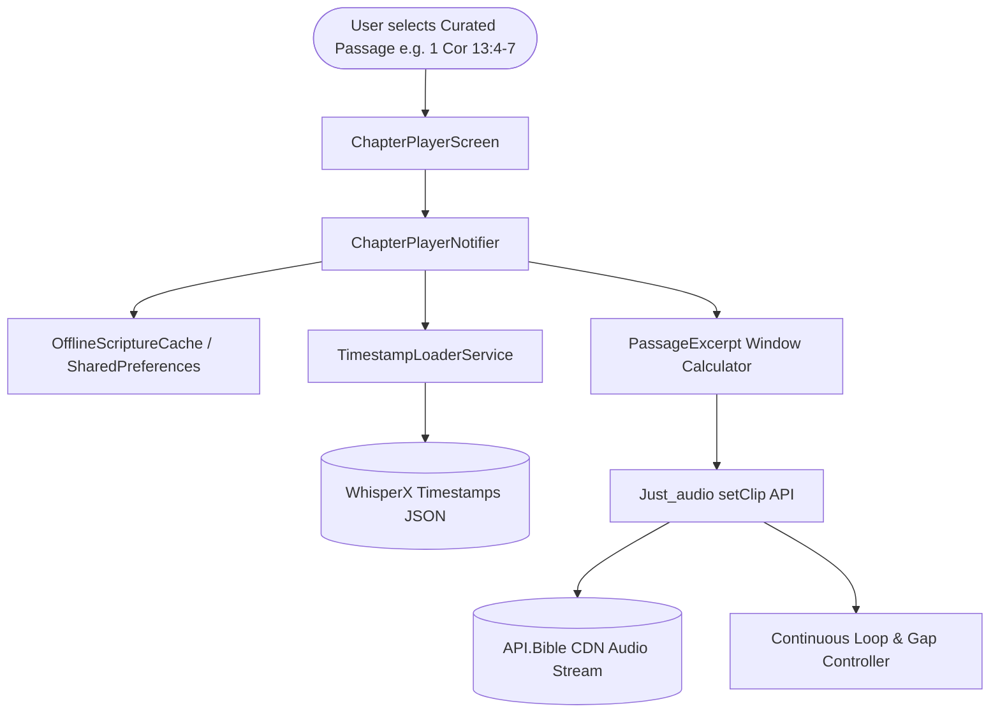

# Product Requirements Document (PRD) & Use Cases Guide
## Selah: Continuous Scripture Audio Meditation
**Target Milestones**: `v0.2.4` (POC Hardening) & `v0.3.0` (Immersive Meditation & Walking Mode)  
**Audience**: Product Leaders, Donors, Non-Technical Scripture Meditators, Senior Mobile Engineers

---

## 1. Executive Summary & Philosophy

### What is Selah?
**Selah** (Hebrew: סֶלָה‎ — *pause, and calmly reflect*) is an open-source, mobile and PWA scripture meditation application. Unlike standard Bible apps that prioritize fast visual reading, Selah is engineered for **continuous auditory immersion and biblical memorization**. 

### The Core Problem
Many believers, commuters, walkers, and busy professionals want to meditate on Scripture throughout the day. However:
1. Conventional audio Bible apps treat Scripture as an audiobook: a chapter plays once and stops, forcing users to repeatedly pull out their phone to rewind.
2. Standard APIs (like API.Bible) deliver **whole-chapter audio streams** (e.g., all 5 minutes of 1 Corinthians 13), making it impossible to focus on a short, targeted passage (e.g. 1 Cor 13:4–7) without hearing the entire chapter.
3. Offline or airplane mode support is often non-existent or restricted to massive multi-gigabyte downloads.

### The Selah Solution
1. **Precision Audio Clipping**: Using AI speech alignment (**WhisperX**), Selah identifies the exact sub-second timestamp of every verse and clips whole-chapter narrator streams to play *only* the chosen passage.
2. **Infinite Looping with Peace Gaps**: A customizable 3–10 second silent gap between repetitions allows users to pray, ponder, and commit the passage to heart without touching the device.
3. **Translation Shuffling**: Automatically alternates between Berean Standard Bible (BSB), World English Bible (WEB), and New International Version (NIV) across loop iterations to deepen linguistic understanding.
4. **Walking Mode**: Seamless background audio, lockscreen playback controls, and offline caching enable continuous listening while walking, driving, or resting.

---

## 2. Target Personas & Use Cases

### Persona 1: Sarah — The Morning Commuter & Walker
* **Profile**: 32-year-old nurse, walks 3 miles every morning before sunrise.
* **Goal**: Memorize 1 Corinthians 13:4–7 ("Love is patient, love is kind...").
* **Pain Points**: Cold morning air, gloves on; cannot stop and look at a phone screen.
* **Selah Experience**:
  - Taps the curated chip **"1 Cor 13:4–7"**.
  - Puts the phone in her coat pocket.
  - The narrator reads Verses 4–7. A gentle 5-second silence follows. The excerpt repeats.
  - On the third repetition, Translation Shuffle cycles from BSB to WEB, offering fresh phrasing that reinforces the meaning.

### Persona 2: Pastor David — Sermon Prep & Exegesis
* **Profile**: 54-year-old pastor preparing a Sunday sermon on Romans 8.
* **Goal**: Hear how Romans 8:31–39 ("If God is for us, who can be against us?") sounds aloud across different translations.
* **Selah Experience**:
  - Taps **"Rom 8:31–39"**.
  - Toggles the translation badges (**BSB** vs. **WEB**) to compare cadence and word emphasis.
  - Verifies that the karaoke highlight moves synchronously with the narrator's voice.

### Persona 3: Marcus — Evening Calming Meditation
* **Profile**: 24-year-old software engineer struggling with insomnia and anxiety.
* **Goal**: Fall asleep dwelling on Psalm 23 ("The LORD is my shepherd").
* **Selah Experience**:
  - Sets repetition to **3 iterations** with a **10-second gap**.
  - Taps **"Psalm 23"**.
  - Listens in bed without blue-light screen glare; lockscreen controls allow pause/resume if needed.

---

## 3. Technical vs. Non-Technical Architecture

### Non-Technical Explanation
Think of a standard Scripture audio recording like a full record album. If you only want to hear a specific chorus, you normally have to manually move the record needle. Selah's **WhisperX alignment engine** acts like a master DJ: it marks the exact millisecond where verse 4 begins (00:39.600) and where verse 7 ends (01:14.280). When you press Play, Selah instantly jumps to verse 4, plays through verse 7, pauses for your chosen prayer reflection time, and repeats seamlessly.

### Technical Explanation
1. **PassageExcerpt Domain Entity**: Defines curated verse ranges (`startVerse`, `endVerse`) and computes a `ClipWindow(start: Duration, end: Duration)` by querying verse timestamps.
2. **Native Clipping via `ClippingAudioSource`**: Rather than downloading and re-encoding audio files with server-side FFmpeg, Selah wraps the audio stream in `ClippingAudioSource(child: AudioSource.uri(...), start: window.start, end: window.end)`. On Android, this compiles into ExoPlayer's native `ClippingMediaSource`, achieving **sub-millisecond clipping accuracy**, zero server transcoding overhead, and instant excerpt playback.
3. **Guardrail Strategy**: Custom verse ranges not yet aligned via WhisperX (e.g. `col 1:17-20`) trigger an informative floating SnackBar informing the user that whole-chapter audio is available while verse-level alignment is on the active roadmap.

### Audio Licensing, Caching Boundaries & Visible Attribution
Selah strictly adheres to copyright and third-party content licensing terms, particularly concerning **API.Bible** audio delivery:

1. **Offline Metadata & WhisperX Timestamp JSON Bundling**:
   - Text metadata and WhisperX timestamp JSONs (`assets/timestamps/<TRANS>/<BOOK>_<CH>.json`) are bundled and cached **100% offline** for all translations, including proprietary licensed translations like the NIV.
   - Timestamp JSONs contain only structural metadata (`verse`, `startMs`, `endMs`, text snippet), NOT audio bytes, and are fully compliant for offline storage. This enables instant excerpt window calculations for all translations without network overhead.

2. **Audio Streaming vs. Offline Caching Rules**:
   - **Public Domain / Open Access Audio (BSB, WEB)**: The Berean Standard Bible and World English Bible audio recordings are open-access / public domain. They may be optionally cached to local storage or bundled offline without licensing conflicts.
   - **Proprietary Licensed Audio (NIV — Biblica / Zondervan)**: API.Bible audio streams for licensed third-party narrations (e.g., the Max McLean NIV Listener's Bible) strictly prohibit permanent offline audio file caching or disk export. NIV audio operates exclusively as on-demand ephemeral streams. When network connectivity is unavailable, the application gracefully falls back to local Text-to-Speech (TTS) narration with clear visual notification.

3. **Mandatory Visible Attribution UI Specifications**:
   - Every player screen and lockscreen interface must visibly display:
     - The translation name and abbreviation (e.g., `New International Version (NIV)` or `Berean Standard Bible (BSB)`).
     - Upstream data provider attribution (`API.Bible`).
     - Specific copyright notice and licensing metatext required by the copyright owner (e.g., Biblica / Zondervan copyright notice for NIV).
   - In accordance with API.Bible Fair Use Management System (FUMS), `fumsToken` telemetry tokens are audited and captured upon stream initialization.

---

## 4. Curated Passages Catalog (v0.2.4 Baseline)

| Reference | Display Title | Book / Chapter | Verses Span | BSB Timestamp Window | WEB Timestamp Window |
| :--- | :--- | :--- | :--- | :--- | :--- |
| **1 Corinthians 13:4–7** | `1 Cor 13:4–7` | 1CO 13 | 4–7 | 39,600ms – 74,280ms | 38,120ms – 73,500ms |
| **Matthew 11:28–30** | `Matt 11:28–30` | MAT 11 | 28–30 | 185,420ms – 212,800ms | 182,100ms – 209,400ms |
| **Romans 8:31–39** | `Rom 8:31–39` | ROM 8 | 31–39 | 248,100ms – 342,600ms | 244,300ms – 338,900ms |
| **Psalm 23:1–6** | `Psalm 23` | PSA 23 | 1–6 | 0ms – 78,500ms | 0ms – 81,200ms |

---

## 5. Non-Technical Next Steps & Roadmap

### Milestone v0.2.4 (Current Focus — POC Hardening)
- [x] Curated passage chips for 1 Cor 13, Matt 11, Rom 8, and Psalm 23.
- [x] Offline scripture cache and text bundling for instant airplane-mode playback.
- [x] Uncurated verse search guardrail with friendly "Feature coming soon" guidance.
- [x] Human-readable Gherkin specifications and automated BDD widget test suite.
- [ ] Visual verification artifacts (ADB screenshots & Marionette UI capture).

### Milestone v0.3.0 (Walking Mode & Core Expansion)
- [ ] Lockscreen playback controls and background audio service (`just_audio_background`).
- [ ] Design System extraction (`AppColors`, `AppSpacing`, `AppTypography`).
- [ ] Whole-New Testament WhisperX batch alignment pipeline (Issue #19).
- [ ] Evaluation of typed `pub.dev/packages/retrofit` for API.Bible client (Issue #20).

### Milestone v0.4.0+ (Production Rebranding & Multi-Voice)
- [ ] Migrate prototype repository to clean organization repo `selah-audio` (Issue #23).
- [ ] Community feature voting and direct telemetry integration.
