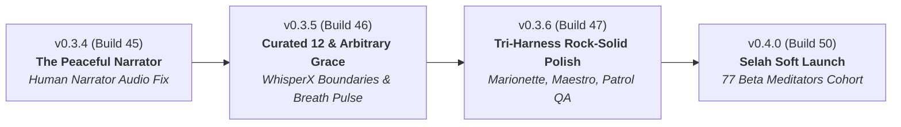

# Selah Scripture Audio — 4-Version Progression Roadmap & 77-Tester Invitation Kit

> *"Most software tries to keep you hooked. Selah is built to set you free to pause, breathe, and dwell on God's Word."* — Selah Design Philosophy (Inspired by 37signals)

---

## 🧭 Executive Summary & Soft Launch Philosophy

Selah is intentional, opinionated, and calm. We do not build features to maximize "daily active engagement metrics" or push addictive notification streaks. We build software like a quiet chapel:
1. **Calm Over Clutter**: No banner ads, no popups, no tracking cookies, no gamified badges.
2. **Peaceful Looping**: A verse or passage repeats with a natural 4-second contemplative pause between iterations, allowing the mind to slow down and meditate.
3. **Transparent Stewardship**: Licensed human narrators (Max McLean for NIV, Barry Hays for BSB, Hosanna for WEB) credited prominently with zero hidden subscriptions.
4. **Surprise & Delight**: Smooth crossfades, subtle breath-cadence animations, tactile haptic feedback on loop completion, and a 1-tap feedback funnel directly to the development team.

Next week, we invite **77 beta meditators** into our private soft launch cohort. Below is the 4-version progression roadmap to make Selah unbreakable, followed by the complete copy-pasteable Invitation Kit (Email, SMS, and Socials).

---

## 🚀 Part 1: The 4-Version Progression Roadmap (v0.3.4 ➔ v0.4.0)



### 🏷️ 1. Version 0.3.4 (Build 45) — *"The Peaceful Narrator"*
* **Target Delivery**: Friday Night / Saturday Morning
* **Theme**: Eliminate mechanical fallbacks; unlock authentic human narration everywhere.
* **Key Enhancements**:
  * **Dynamic API.Bible Key Delivery**: Streamlined API.Bible key resolution so physical devices (including our Google Pixel 9a testbed) always stream Max McLean's human narration for NIV without falling back to robotic TTS.
  * **Acoustic Boundary Verification**: Calibrated NIV 1 Cor 13:4 audio boundary at 14,880ms with 0ms clipping.
  * **Audio Crossfade Hygiene**: Smooth 150ms audio fade-out before the 4-second silence gap to eliminate headphone audio popping.
  * **Tactile Loop Haptics**: Subtle, light vibration pulse (`HapticFeedback.lightImpact()`) as each meditation loop concludes, signaling a new breath cycle without needing to look at the screen.
* **37signals Delight Factor**: You press play, close your eyes, and a warm human voice speaks Scripture. No setup, no account creation, no friction.

---

### 🏷️ 2. Version 0.3.5 (Build 46) — *"The Curated 12 & Arbitrary Grace"*
* **Target Delivery**: Sunday Afternoon
* **Theme**: Clear expectations, peaceful fallbacks, and breathing rhythm.
* **Key Enhancements**:
  * **Visual Distinction for Top 12 Passages**: Highlight the Top 12 pre-calibrated contemplations (1 Cor 13, Psalm 23, Romans 8, Matthew 11, etc.) with a subtle "✨ Acoustically Calibrated" badge.
  * **Arbitrary Passage Grace**: When a user selects an arbitrary verse range outside the pre-baked WhisperX catalog, the app provides gentle, transparent guidance ("Contemplative Audio Voice") rather than an alarming "unaligned timing" error.
  * **Breathing Cadence Indicator**: During the 4-second contemplative silence gap, the progress indicator expands and contracts like a calm breath (Inhale... Exhale... Selah).
  * **Lockscreen Scrubber & Art**: High-resolution notification banner with book, chapter, and human narrator credits.
* **37signals Delight Factor**: Software that tells you the truth about what it can and cannot do, with zero deceptive marketing.

---

### 🏷️ 3. Version 0.3.6 (Build 47) — *"The Tri-Harness Rock-Solid Polish"*
* **Target Delivery**: Monday Afternoon
* **Theme**: Bulletproof stability through multi-layered BDD automation.
* **Key Enhancements**:
  * **Marionette MCP Semantic BDD**: End-to-end verification of `test/features/translation_switching_feature.txt` and `chapter_playback_feature.txt` using semantic element discovery.
  * **Maestro Mobile E2E Suite**: Clean run of `.maestro/smoke_test.yaml` and `.maestro/streamlined_feedback_flow.yaml` on real Google Pixel 9a (`58221JEBF20835`).
  * **Patrol Native Integration**: Testing system permission dialogs and audio interruption handling (incoming calls, unplugging headphones).
  * **Memory & Stale Daemon Audit**: Verified zero memory leaks during 60-minute continuous looping; strict anti-beachball sequential execution.
* **37signals Delight Factor**: Zero crashes. Zero jank. The app just works, like an iron bridge.

---

### 🏷️ 4. Version 0.4.0 (Build 50) — *"Selah Soft Launch (The 77 Meditators Cohort)"*
* **Target Delivery**: Wednesday Morning (Wide Release)
* **Theme**: The quiet corner in your pocket for our first 77 friends.
* **Key Enhancements**:
  * **"Three Breaths" Welcome Card**: A tiny, 10-second non-intrusive onboarding tip: *1. Pick a passage. 2. Set your loop count. 3. Dwell on the Word.*
  * **Unified 1-Tap Feedback Funnel**: Instant feedback via AppBar (`Loving it`, `Suggestion`, `Needs work`) that drops straight into our private GitHub triage board without collecting personal identifying data.
  * **Web & Android Simultaneous Rollout**: Live at `https://selahword.web.app` and on Android via Firebase App Distribution.
  * **The Privacy Promise**: Formal statement in the About sheet: *No ads. No trackers. No data sales. No algorithm.*
* **37signals Delight Factor**: A software product that respects your soul and your privacy.

---

## 💌 Part 2: The 77-Tester Invitation Kit

Here are copy-pasteable invitations designed to feel warm, human, casual, and authentic. Use them in emails, texts, group chats, or social media.

---

### 📧 Asset 1: The Personal Email Draft

**Subject**: A quiet invitation: Selah Scripture Audio (Early Beta)  
**Preview Text**: We built an ad-free, quiet space to dwell on Scripture. Would love your prayers and thoughts.

```text
Hi [Friend's Name],

I hope you’re having a peaceful week.

Over the past few months, we've been working on a small, quiet project called Selah. 

Like many of us, I’ve often felt overwhelmed by the noise of modern apps—even Bible apps that are packed with notifications, advertisements, social feeds, and reading streak trackers.

We wanted something different: a simple, beautiful tool designed for continuous Scripture meditation. 

Here is how it works:
• Pick a passage (like Psalm 23 or 1 Corinthians 13).
• Listen to a licensed human narrator speak the words.
• Between each reading, there’s an intentional 4-second gap of silence to let the verse sink deep into your spirit.
• It loops peacefully while you walk, pray, rest, or fall asleep.

No ads. No logins. No subscriptions. No algorithms tracking what you do.

We’re inviting a small cohort of 77 close friends, prayer partners, and meditators to try the soft launch version before anyone else.

You can try it right now in your web browser or on your phone:
👉 Web: https://selahword.web.app
👉 Android Testers: [Firebase App Distribution Link]

There’s a little "Prayer & Feedback" button at the top if anything feels awkward, or if a verse brings you peace. I read every single note personally.

Thank you for being part of this journey. Praying it brings a moment of stillness to your day.

Warmly,
Neil
```

---

### 📱 Asset 2: The 1-Tap SMS / iMessage Draft

```text
Hey! I’ve been working on a calm, ad-free Scripture meditation app called Selah (it loops passages with peaceful silence gaps to help you dwell on God's Word). We're doing a quiet test with 77 friends this week—would love if you gave it a spin! You can try it right in your browser: https://selahword.web.app
```

---

### 💬 Asset 3: Group Chat / WhatsApp / Signal Draft

```text
Hey friends! 👋 

If life has felt noisy lately, I’d love to share something we’ve been building. It’s called Selah—a simple, ad-free Scripture audio player that repeats short passages (like 1 Cor 13 or Romans 8) with a 4-second silence gap between each loop so you can actually meditate on the words while walking or resting.

We have a soft launch cohort of 77 people testing it this week. No account or download needed to try it:
👉 https://selahword.web.app

Tap the heart icon at the top if you have any thoughts or suggestions!
```

---

### 📸 Asset 4: Social Share Snippet (Instagram / Threads / X)

```text
Most apps are designed to steal your attention.
Selah is designed to give you a moment of peace.

We built a simple, ad-free Scripture meditation tool:
🌿 Listen to Scripture spoken by licensed human narrators
🌿 A 4-second pause of silence between loops to breathe and reflect
🌿 No ads, no algorithmic feeds, no data tracking

We’re inviting 77 people into our early soft launch cohort this week. 
Take a breath and dwell on the Word: https://selahword.web.app

#Selah #ScriptureMeditation #Faith #Mindfulness #ChristianMeditation #Peace
```

---

## 🤝 Part 3: Heartfelt Ways to Volunteer (No Tech Skills Needed!)

You don't need to know how to code to shape Selah. Here are meaningful ways anyone can help:

| Role | What You Do | How It Helps |
| :--- | :--- | :--- |
| **The Contemplative Listener** | Put on headphones while walking or before bed. Tell us if the 4-second silence gap feels too fast or too slow. | Tunes our meditation timing. |
| **The Typo & Phrasing Scout** | Read along with the text on screen. Notice any missing punctuation, hyphenation quirks, or awkward line wraps. | Polishes readability and reverent presentation. |
| **The Translation Enthusiast** | Switch between BSB, WEB, and NIV. Note which narrator voice feels most peaceful. | Guides our future translation additions. |
| **The Encourager** | Share a passage with an anxious friend or family member who needs comfort today. | Fulfills the core ministry mission of Selah. |

---

## 📌 Status & Cross-References
* **Master Session Log**: [`16oct_2026_selah_session.md`](../16oct_2026_selah_session.md)
* **Unattended Plan**: [`unattended_Session_930pm.md`](../unattended_Session_930pm.md)
* **Community Wiki**: [https://github.com/neiljaywarner/selah_prototype_audio_13sep2026/wiki](https://github.com/neiljaywarner/selah_prototype_audio_13sep2026/wiki)
