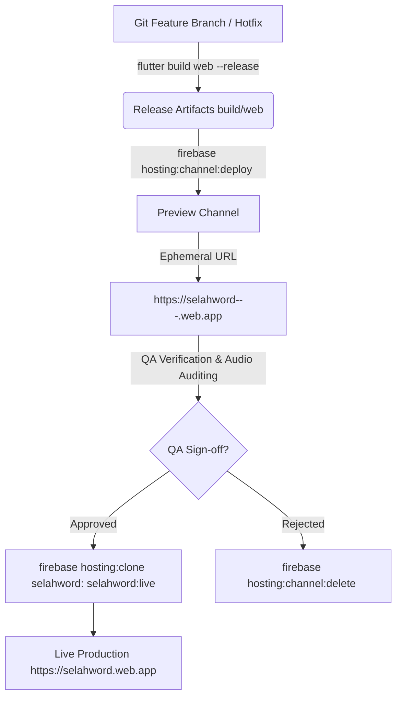

# Wiki: Firebase Hosting Preview Channels

> **Location**: `docs/wiki/Firebase-Hosting-Preview-Channels.md`  
> **Target Audience**: Core Engineers, QA Testers, and Product Maintainers

---

## Overview

Firebase Hosting **Preview Channels** provide ephemeral, fully isolated environments for deploying and verifying changes in the Selah Scripture Audio Meditation web client prior to production release.

Because live users actively access the primary production URL (`https://selahword.web.app`), direct deploys to the `live` channel are prohibited for unverified or experimental code.

---

## Architectural Isolation



### Key Safety Guarantees

1. **Origin Separation**:
   - Each preview channel receives a distinct suborigin (`https://selahword--<channel-name>-<hash>.web.app`).
   - LocalStorage, IndexedDB, and PWA CacheStorage are isolated per origin. Staging builds cannot poison production user states.

2. **Search Engine Protection**:
   - Every response from a preview channel automatically includes the header `X-Robots-Tag: noindex`.
   - Googlebot and other indexing spiders ignore preview channels.

3. **Time-To-Live (TTL)**:
   - Channels automatically expire after 7 days (or custom duration via `--expires`).
   - Prevents stale environments from accumulating.

---

## Command Reference

### 1. Deploying a Preview Channel
```bash
# General syntax
firebase hosting:channel:deploy <channel_id>

# Example: Hotfix verification
firebase hosting:channel:deploy hotfix-v0-3-1

# Example: PR testing with 48-hour expiration
firebase hosting:channel:deploy pr-90 --expires 48h
```

### 2. Inspecting Active Channels
```bash
firebase hosting:channel:list --site selahword
```

### 3. Promoting to Live Channel (Zero-Rebuild Clone)
```bash
firebase hosting:clone selahword:<channel_id> selahword:live
```

### 4. Deleting a Channel Early
```bash
firebase hosting:channel:delete <channel_id> --site selahword
```

---

## Verification Runbook for Preview Channels

When validating a preview URL:

1. **Verify Headers & Status**:
   ```bash
   curl -I https://selahword--<channel_id>-<hash>.web.app
   ```
   Confirm `HTTP/2 200` and `x-robots-tag: noindex`.

2. **Verify Scripture Audio Playback**:
   - Test BSB (Berean Standard Bible) bundled audio.
   - Test WEB (World English Bible) online streaming.
   - Test NIV excerpt text and verify Text-to-Speech (TTS) fallback plays smoothly without claiming "Offline / Airplane Mode".

3. **Verify Firebase Analytics Integration**:
   - Confirm Google tag `G-7LFS54TTFM` fires in browser DevTools.
   - Verify events populate Firebase DebugView in real time.

4. **Verify Mobile Responsive Design**:
   - Open on iOS Safari and Android Chrome viewports.
   - Confirm player controls, scrub bar, speed picker, and version footer format cleanly.
