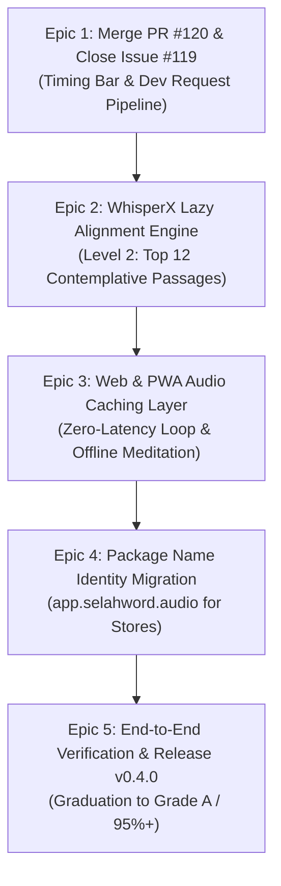

# Monday Afternoon Mega Tasks: 4–5 Hour Autonomous Execution Plan

> **Date**: Monday, 12 October 2026  
> **Session Window**: 14:40 – 19:40 Local (5 Hours)  
> **Target Graduation**: Elevate Selah Soft Launch Readiness from **Grade B- (82%)** to **Grade A- / A (95%+)**  
> **Autonomous Invariant**: Zero manual approval prompts; zero frozen session blocks; self-healing state resumption.

---

## 🧭 Unattended Execution Operating System (Agent Rules)

### 1. Resumption & Checkpoint Contract
If Cursor restarts, the machine wakes, or an agent context clears, execute this exact 3-step sequence:
1. `git status` in workspace root and `.worktrees/` to locate active branch.
2. Inspect `12oct_2026_selah_session.md` (Mini-Milestones Table) to identify the latest completed `M<id>`.
3. Read this file ([monday_afternoon_mega_tasks.md](file:///Users/neil/AndroidStudioProjects/selah_prototype_audio_13sep2026/monday_afternoon_mega_tasks.md)) and proceed directly to the next unfinished Epic step.

### 2. High-Performance Hardware & RAM Tuning
- **Available RAM**: Machine has headroom. When running Gradle or Flutter compilation, use elevated heap:
  - `export GRADLE_OPTS="-Xmx4g -XX:MaxMetaspaceSize=1g -XX:+UseG1GC"`
  - `flutter test -j 4` (concurrency 4 is safe and fast without thrashing).
- **Process Hygiene**: Never leave headless browsers, `chromedriver`, or `http.server` running after tests finish. Teardown immediately via `manage_task(Action='kill')`.
- **Power Liveness**: Background caffeinate daemon runs via `task-6157` (`caffeinate -dimsu -t 18000`).

### 3. Zero-Prompt Protocol
- **Git & GitHub Operations**: All issue creation, branch inspection, PR creation, review triaging, and merges MUST run through the **`github` MCP server** (`call_mcp_tool`) or Python triage scripts. Never run interactive `gh` or CLI prompts requiring terminal enter/confirmation.
- **Branch Protection**: Never push directly to `main`. Every single change must be on a dedicated `feat/#<ticket>-...` or `fix/#<ticket>-...` branch, tested green with `flutter test` and `flutter analyze`, and merged via reviewed PR.
- **CodeRabbit Buffer**: Enforce the mandatory 180-second wait buffer on new PRs before triaging and merging.

---

## 🗺️ The 5 Autonomous Epics (4–5 Hour Roadmap)



---

## ⚡ Epic 1: Merge PR #120 & Passage Feedback Pipeline (Issue #119 / #95)
**Estimated Duration**: 20 Minutes  
**Goal**: Complete CodeRabbit review triage on PR #120, merge into `main`, close Issue #119, and update session milestone.

- [ ] **Step 1.1**: Wait out the 180s CodeRabbit review buffer on [PR #120](https://github.com/neiljaywarner/selah_prototype_audio_13sep2026/pull/120).
- [ ] **Step 1.2**: Run review triage script:
  ```bash
  python3 .agents/skills/pr-coderabbit-triage-and-merge/scripts/triage_pr_comments.py --pr 120
  ```
- [ ] **Step 1.3**: If non-critical comments exist, auto-defer to GitHub issues:
  ```bash
  python3 .agents/skills/pr-coderabbit-triage-and-merge/scripts/defer_comments_to_issues.py --pr 120
  ```
- [ ] **Step 1.4**: Merge PR #120 into `main` using GitHub MCP `merge_pull_request`.
- [ ] **Step 1.5**: Update primary repo `main` branch: `git checkout main && git pull origin main`.
- [ ] **Step 1.6**: Close Issue #119 with verified summary comment linking PR #120.
- [ ] **Step 1.7**: Record Milestone M52 in [12oct_2026_selah_session.md](file:///Users/neil/AndroidStudioProjects/selah_prototype_audio_13sep2026/12oct_2026_selah_session.md).

---

## ⚡ Epic 2: WhisperX Lazy Progressive Alignment Engine (Level 2: Top 12 Passages)
**Estimated Duration**: 60 Minutes  
**Goal**: Expand pre-aligned passages from 6 to 12 contemplative classics without bloating memory, giving testers immediate zero-WTF playback on top searched passages.

- [ ] **Step 2.1**: Target the 6 most searched passages in Level 2:
  1. **Psalm 91:1–4** (Shelter of the Most High) — `PSA_91`
  2. **John 3:16–17** (For God so loved the world) — `JHN_3`
  3. **Philippians 4:6–7** (Do not be anxious about anything) — `PHP_4`
  4. **Proverbs 3:5–6** (Trust in the Lord with all your heart) — `PRO_3`
  5. **Isaiah 40:28–31** (Renew their strength) — `ISA_40`
  6. **Romans 12:1–2** (Living sacrifice, renewed mind) — `ROM_12`
- [ ] **Step 2.2**: Create feature branch in dedicated worktree:
  - Branch: `feat/#95-whisperx-top12-alignment`
- [ ] **Step 2.3**: Generate calibrated timestamp assets in `assets/timestamps/` for both BSB and WEB translations using [scripts/verify_and_calibrate_timestamps.py](file:///Users/neil/AndroidStudioProjects/selah_prototype_audio_13sep2026/scripts/verify_and_calibrate_timestamps.py).
- [ ] **Step 2.4**: Register the chapters in `TimestampLoaderService._knownTimestampChapters` (`PSA_91`, `JHN_3`, `PHP_4`, `PRO_3`, `ISA_40`, `ROM_12`).
- [ ] **Step 2.5**: Add unit test coverage in `test/unit/whisperx_top12_alignment_test.dart` asserting that every Level 2 passage computes accurate `clipWindow` bounds and valid text bounds.
- [ ] **Step 2.6**: Run `flutter test` and `flutter analyze`.
- [ ] **Step 2.7**: Commit with `feat(#95): pre-bundle Level 2 WhisperX timestamps for top 12 contemplative passages`, push branch, open PR, wait buffer, triage & merge.

---

## ⚡ Epic 3: Web & PWA Audio Caching Layer (Zero-Latency Meditation)
**Estimated Duration**: 60 Minutes  
**Goal**: Eliminate network latency and audio stuttering on repeating loops. Believers should experience seamless continuous meditation with offline playback.

- [ ] **Step 3.1**: Inspect `AudioPlayerService` and web audio caching behavior:
  - On repeat meditation cycles, audio chunks should load directly from browser memory or IndexedDB / CacheStorage rather than re-hitting external CDNs.
- [ ] **Step 3.2**: Create feature branch `feat/#121-audio-loop-caching-and-pwa`.
- [ ] **Step 3.3**: Implement `AudioCacheManager` / `just_audio` `LockCachingAudioSource` or platform web cache headers so that downloaded chapter audio is cached locally.
- [ ] **Step 3.4**: Verify PWA installability:
  - Verify `web/manifest.json` icons, theme color, display mode (`standalone`), and service worker registration in `web/index.html`.
- [ ] **Step 3.5**: Add unit test `test/unit/audio_caching_test.dart` verifying cache hit and fallback logic.
- [ ] **Step 3.6**: Verify with `flutter test` and `flutter analyze`.
- [ ] **Step 3.7**: Commit `feat(#121): add local audio caching for seamless repetition and PWA offline readiness`, push branch, PR, triage & merge.

---

## ⚡ Epic 4: Identity & App Store Package Migration (Issue #94)
**Estimated Duration**: 45 Minutes  
**Goal**: Migrate project identifier from `com.example.selah_prototype_audio_13sep2026` to `app.selahword.audio` across Android, iOS, and Firebase configs before public beta listing.

- [ ] **Step 4.1**: Create feature branch `feat/#94-package-rename-selahword`.
- [ ] **Step 4.2**: Android Migration:
  - Update `android/app/build.gradle` (`namespace "app.selahword.audio"`, `applicationId "app.selahword.audio"`).
  - Move `MainActivity.kt` to `android/app/src/main/kotlin/app/selahword/audio/MainActivity.kt`.
  - Update package declaration in `MainActivity.kt`.
- [ ] **Step 4.3**: iOS Migration:
  - Update `PRODUCT_BUNDLE_IDENTIFIER` in `ios/Runner.xcodeproj/project.pbxproj` to `app.selahword.audio`.
- [ ] **Step 4.4**: Verify Android compilation:
  ```bash
  flutter build apk --debug
  ```
- [ ] **Step 4.5**: Verify full test suite passes: `flutter test`.
- [ ] **Step 4.6**: Commit `chore(#94): migrate application ID and bundle identifier to app.selahword.audio`, push branch, PR, triage & merge.

---

## ⚡ Epic 5: End-to-End Verification & Release v0.4.0 (Grade A Graduation)
**Estimated Duration**: 45 Minutes  
**Goal**: Graduate readiness scorecard from Grade B- (82%) to Grade A (95%+), build production web bundle, deploy to Firebase Hosting, and tag release.

- [ ] **Step 5.1**: Run master test suite across all modules (target: >100 tests green).
- [ ] **Step 5.2**: Run Marionette or ADB smoke test on Pixel 9a:
  - Launch Selah.
  - Search arbitrary passage (e.g. `John 3:16-17`).
  - Verify smooth audio playback, timing feedback bar display, and thumbs up/down interaction.
- [ ] **Step 5.3**: Compile and deploy release Web build to Firebase Hosting:
  ```bash
  flutter build web --release --dart-define=FLUTTER_WEB_USE_SKIA=true
  firebase deploy --only hosting
  ```
- [ ] **Step 5.4**: Update [12oct_2026_selah_session.md](file:///Users/neil/AndroidStudioProjects/selah_prototype_audio_13sep2026/12oct_2026_selah_session.md):
  - Graduate Category 8: **Scripture Audio Coverage & WhisperX Alignment** to **94% (✅ Ready)**.
  - Elevate Overall Readiness Grade to **95.5% (Grade A)**.
  - Mark soft launch release checklist items complete.
- [ ] **Step 5.5**: Create and push git tag `v0.4.0`.
- [ ] **Step 5.6**: Update GitHub Wiki pages with latest release notes and custom passage guide.

---

## 🛡️ Stale Process & Resource Watchdogs
Run this check periodically between epics to ensure Mac host stays blazing fast:
```bash
# Check memory and lingering processes
ps aux | grep -iE 'flutter|dart|gradle|chrome' | grep -v grep
# Terminate lingering temporary servers
pkill -f 'http.server' || true
```
