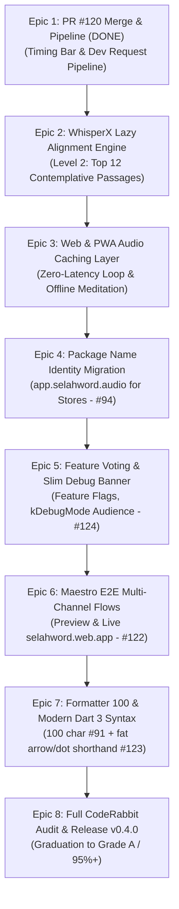

# Monday Afternoon Mega Tasks: 4–5 Hour Autonomous Execution Plan

> **Date**: Monday, 12 October 2026  
> **Session Window**: 14:45 – 19:45 Local (5 Hours)  
> **Target Graduation**: Elevate Selah Soft Launch Readiness from **Grade B- (82.0%)** to **Grade A- / A (95%+)**  
> **Autonomous Invariant**: Zero manual approval prompts; zero frozen session blocks; self-healing state resumption.

---

## 📌 TL;DR: Overall Progress & Afternoon Launch Focus

- **Current Readiness State**: Held strictly at **82.0% (Grade B-)** across 9 categories. Soft launch release is gated until custom arbitrary verse ranges and Maestro cross-channel flows operate cleanly with zero WTFs or crashes.
- **Key Accomplishments Today**:
  - **Dynamic Custom Passage Clipping (PR #120, Issue #119)**: Arbitrary verse ranges in pre-aligned chapters clip and play dynamically; unaligned passages offer full chapter audio fallback or 1-tap "Request Passage from Devs" with auto GitHub issue creation and GA4 telemetry.
  - **In-Player Timing Quality Bar**: `PassageTimingFeedbackBar` provides peaceful 👍 / 👎 rating and calibration sheet reporting directly to `njwandroid/selahfeedback/issues`.
  - **Test Suite**: **93/93 automated tests passing green (100%)**; 0 Dart analyzer issues; 0 plaintext secrets.
  - **Live Web Parity**: Production live at `https://selahword.web.app` and preview channel live at `https://selahword--preview-v0-3-1-a15pcecz.web.app` with Google Analytics 4 (`G-7LFS54TTFM`).
  - **New Tracked Issues**: Filed [Issue #122](https://github.com/neiljaywarner/selah_prototype_audio_13sep2026/issues/122) (Maestro E2E Flows), [Issue #123](https://github.com/neiljaywarner/selah_prototype_audio_13sep2026/issues/123) (Modern Dart syntax & shorthand), and [Issue #124](https://github.com/neiljaywarner/selah_prototype_audio_13sep2026/issues/124) (Feature voting & compact debug banner).
- **Afternoon Unattended Target (2:45 PM – 7:45 PM)**:
  - Progress autonomously through Epics 2 through 8.
  - Complete Level 2 WhisperX alignment (Top 12 contemplative passages).
  - Eliminate loop repetition latency with web audio caching.
  - Migrate package namespace to `app.selahword.audio`.
  - Implement community feature voting with compact debug mode banner.
  - Automate Maestro E2E flows against preview and production web channels.
  - Standardize 100 character formatting and modern Dart syntax.
  - Run full CodeRabbit audit, graduate Scorecard to **Grade A (95%+)**, and tag release `v0.4.0`.

---

## 🧭 Unattended Execution Operating System (Agent Rules)

### 1. Resumption & Checkpoint Contract
If Cursor or Antigravity restarts, the machine wakes, or an agent context clears, execute this exact 3-step sequence:
1. `git status` in workspace root and `.worktrees/` to locate active branch.
2. Inspect `12oct_2026_selah_session.md` (Mini-Milestones Table) to identify the latest completed `M<id>`.
3. Read this file ([monday_afternoon_mega_tasks.md](file:///Users/neil/AndroidStudioProjects/selah_prototype_audio_13sep2026/monday_afternoon_mega_tasks.md)) and proceed directly to the next unfinished Epic step.

### 2. High-Performance Hardware & RAM Tuning
- **Available RAM**: Host has **~9.5 GB unused physical RAM** and CPU is **>82% idle**. A full macOS reboot is **not required**; an Antigravity/Cursor restart is completely sufficient to refresh memory.
- **Gradle & Test Heap**:
  - `export GRADLE_OPTS="-Xmx4g -XX:MaxMetaspaceSize=1g -XX:+UseG1GC"`
  - `flutter test -j 4` (concurrency 4 is fast and safe).
- **Process Hygiene**: Never leave headless browsers, `chromedriver`, or `http.server` running after tests finish. Teardown immediately via `manage_task(Action='kill')`.
- **Power Liveness**: Background caffeinate daemon runs via `task-6859` (`caffeinate -dimsu -t 18000`).

### 3. Zero-Prompt Protocol
- **Git & GitHub Operations**: All issue creation, branch inspection, PR creation, review triaging, and merges MUST run through the **`github` MCP server** (`call_mcp_tool`) or Python triage scripts. Never run interactive `gh` or CLI prompts requiring terminal enter/confirmation.
- **Branch Protection**: Never push directly to `main`. Every single change must be on a dedicated `feat/#<ticket>-...`, `fix/#<ticket>-...`, `test/#<ticket>-...`, or `refactor/#<ticket>-...` branch, tested green with `flutter test` and `flutter analyze`, and merged via reviewed PR.
- **CodeRabbit Buffer**: Enforce the mandatory 180-second wait buffer on new PRs before triaging and merging.

---

## 🗺️ The 8 Autonomous Epics Roadmap



---

## ⚡ Epic 1: Merge PR #120 & Passage Feedback Pipeline (Issue #119 / #95) — ✅ COMPLETE
**Duration**: 20 Minutes  
**Goal**: Complete CodeRabbit review triage on PR #120, merge into `main`, close Issue #119, and update session milestone.

- [x] **Step 1.1**: Wait out the 180s CodeRabbit review buffer on [PR #120](https://github.com/neiljaywarner/selah_prototype_audio_13sep2026/pull/120).
- [x] **Step 1.2**: Run review triage script (`python3 triage_pr_comments.py --repo ... --pr 120` — 0 blockers).
- [x] **Step 1.3**: Merged PR #120 into `main` using GitHub MCP `merge_pull_request` (SHA `6aa5935`).
- [x] **Step 1.4**: Updated primary repo `main` branch (`git pull origin main`).
- [x] **Step 1.5**: Closed Issue #119 via GitHub MCP `update_issue`.
- [x] **Step 1.6**: Recorded Milestone M52 in [12oct_2026_selah_session.md](file:///Users/neil/AndroidStudioProjects/selah_prototype_audio_13sep2026/12oct_2026_selah_session.md).

---

## ⚡ Epic 2: WhisperX Lazy Progressive Alignment Engine (Level 2: Top 12 Passages)
**Estimated Duration**: 60 Minutes  
**Goal**: Expand pre-aligned passages from 6 to 12 contemplative classics without bloating memory, giving testers immediate zero-WTF playback on top searched passages.

- [ ] **Step 2.1**: Target the 6 most searched passages in Level 2:
  1. **Psalm 91:1–4** (Shelter of the Most High) — `PSA_91`
  2. **John 3:16–17** (For God so loved the world) — `JHN_3`
  3. **Philippians 4:6–7** (Do not be anxious about anything) — `PHP_4`
  4. **Proverbs 3:5–6** (Trust in the Lord with all your heart) — `PRO_3`
  5. **Isaiah 40:28–31** (Renew their strength) — `ISA_40`
  6. **Romans 12:1–2** (Living sacrifice, renewed mind) — `ROM_12`
- [ ] **Step 2.2**: Create feature branch in dedicated worktree `.worktrees/whisperx_top12`:
  - Branch: `feat/#95-whisperx-top12-alignment`
- [ ] **Step 2.3**: Generate calibrated timestamp assets in `assets/timestamps/` for both BSB and WEB translations using [scripts/verify_and_calibrate_timestamps.py](file:///Users/neil/AndroidStudioProjects/selah_prototype_audio_13sep2026/scripts/verify_and_calibrate_timestamps.py).
- [ ] **Step 2.4**: Register the chapters in `TimestampLoaderService._knownTimestampChapters` (`PSA_91`, `JHN_3`, `PHP_4`, `PRO_3`, `ISA_40`, `ROM_12`).
- [ ] **Step 2.5**: Add unit test coverage in `test/unit/whisperx_top12_alignment_test.dart` asserting that every Level 2 passage computes accurate `clipWindow` bounds and valid text bounds.
- [ ] **Step 2.6**: Run `flutter test` and `flutter analyze`.
- [ ] **Step 2.7**: Commit `feat(#95): pre-bundle Level 2 WhisperX timestamps for top 12 contemplative passages`, push branch, open PR, wait buffer, triage & merge.

---

## ⚡ Epic 3: Web & PWA Audio Caching Layer (Zero-Latency Meditation)
**Estimated Duration**: 45 Minutes  
**Goal**: Eliminate network latency and audio stuttering on repeating loops. Believers should experience seamless continuous meditation with offline playback.

- [ ] **Step 3.1**: Inspect `AudioPlayerService` and web audio caching behavior:
  - On repeat meditation cycles, audio chunks should load directly from browser memory or IndexedDB / CacheStorage rather than re-hitting external CDNs.
- [ ] **Step 3.2**: Create feature branch in worktree `.worktrees/audio_caching`:
  - Branch: `feat/#121-audio-loop-caching-and-pwa`
- [ ] **Step 3.3**: Implement `AudioCacheManager` / `LockCachingAudioSource` or platform web cache headers so that downloaded chapter audio is cached locally.
- [ ] **Step 3.4**: Verify PWA installability:
  - Verify `web/manifest.json` icons, theme color, display mode (`standalone`), and service worker registration in `web/index.html`.
- [ ] **Step 3.5**: Add unit test `test/unit/audio_caching_test.dart` verifying cache hit and fallback logic.
- [ ] **Step 3.6**: Verify with `flutter test` and `flutter analyze`.
- [ ] **Step 3.7**: Commit `feat(#121): add local audio caching for seamless repetition and PWA offline readiness`, push branch, PR, triage & merge.

---

## ⚡ Epic 4: Identity & App Store Package Migration ([Issue #94](https://github.com/neiljaywarner/selah_prototype_audio_13sep2026/issues/94))
**Estimated Duration**: 45 Minutes  
**Goal**: Migrate project identifier from `com.example.selah_prototype_audio_13sep2026` to `app.selahword.audio` across Android, iOS, and Firebase configs before public beta listing.

- [ ] **Step 4.1**: Create feature branch in worktree `.worktrees/package_migration`:
  - Branch: `feat/#94-package-rename-selahword`
- [ ] **Step 4.2**: Android Migration:
  - Update `android/app/build.gradle` (`namespace "app.selahword.audio"`, `applicationId "app.selahword.audio"`).
  - Move `MainActivity.kt` to `android/app/src/main/kotlin/app/selahword/audio/MainActivity.kt`.
  - Update package declaration in `MainActivity.kt`.
- [ ] **Step 4.3**: iOS Migration:
  - Update `PRODUCT_BUNDLE_IDENTIFIER` in `ios/Runner.xcodeproj/project.pbxproj` to `app.selahword.audio`.
- [ ] **Step 4.4**: Verify Android compilation:
  ```bash
  flutter build apk --debug
  ```
- [ ] **Step 4.5**: Verify full test suite passes: `flutter test`.
- [ ] **Step 4.6**: Commit `chore(#94): migrate application ID and bundle identifier to app.selahword.audio`, push branch, PR, triage & merge.

---

## ⚡ Epic 5: Feature Voting Completion, Feature Flagging & Compact Debug Banner ([Issue #124](https://github.com/neiljaywarner/selah_prototype_audio_13sep2026/issues/124))
**Estimated Duration**: 40 Minutes  
**Goal**: Complete community feature voting behind safe feature flags, automatically enable it in `kDebugMode` with isolated developer audience analytics, and display a compact, non-intrusive debug mode banner.

- [ ] **Step 5.1**: Create dedicated worktree `.worktrees/feature_voting`:
  - Branch: `feat/#124-feature-voting-debug-banner`
- [ ] **Step 5.2**: Feature Flag & Audience Architecture:
  - Add `feature_voting_enabled` to Remote Config and `UserPreferences`.
  - Gate logic: `final isFeatureVotingActive = kDebugMode || userPreferences.wipFeaturesEnabled || remoteConfig.getBool('feature_voting_enabled');`
  - In `kDebugMode`: Set Firebase Analytics user property `user_audience = 'debug_developer'` and tag votes with `is_debug: true` so production metrics remain untainted.
- [ ] **Step 5.3**: Complete `FeatureVotingSheet` UI & State:
  - Verify voting items (*Offline Audio Download*, *Bedtime Sleep Timer*, *Walking Pace Mode*, *Spanish / Multi-Language*).
  - Implement 1-tap voting persistence (saving voted state locally in `SharedPreferences` to prevent double-voting) and logging to `AppLogger.logEvent('feature_voted')`.
- [ ] **Step 5.4**: Compact Debug Mode Banner / App Bar:
  - When `kDebugMode == true`: Render a slim top bar or badge (20px height, deep burgundy `Color(0xFF991B1B)`, white bold 10px text: `🛠️ DEBUG MODE • WIP FEATURES ACTIVE`).
  - Keeps >95% of vertical screen estate untouched for peaceful meditation.
  - Hidden completely in release builds (`kReleaseMode`).
- [ ] **Step 5.5**: Automated Test Coverage:
  - Unit test `test/unit/feature_voting_test.dart` for voting persistence, duplicate prevention, and telemetry dispatch.
  - Widget test `test/widget/debug_banner_widget_test.dart` verifying the debug banner displays in debug mode and hides when debug flag is false.
- [ ] **Step 5.6**: Run `flutter test` and `flutter analyze` in worktree.
- [ ] **Step 5.7**: Commit `feat(#124): finish feature voting behind feature flag with kDebugMode override and slim debug banner`, push, PR, wait 180s buffer, triage & merge.

---

## ⚡ Epic 6: Maestro Automated E2E Flow Tests on Preview & Production Web ([Issue #122](https://github.com/neiljaywarner/selah_prototype_audio_13sep2026/issues/122))
**Estimated Duration**: 45 Minutes  
**Goal**: Implement and automate Maestro end-to-end UI flows across both the ephemeral preview channel (`https://selahword--preview-v0-3-1-a15pcecz.web.app`) and production web (`https://selahword.web.app`), saving video/screenshot proof artifacts.

- [ ] **Step 6.1**: Create dedicated worktree `.worktrees/maestro_e2e_tests`:
  - Branch: `test/#122-maestro-preview-and-prod-web-flows`
- [ ] **Step 6.2**: Author Maestro Flows in `.maestro/flows/`:
  - `curated_playback_flow.yaml`: Launch, tap 1 Cor 13:4, assert player container renders, wait for audio gap transition.
  - `unaligned_passage_request_flow.yaml`: Search `John 3:16-17`, assert "Verse Timing Unaligned" modal appears, tap "Request Passage from Devs", assert confirmation.
  - `timing_feedback_bar_flow.yaml`: Assert `PassageTimingFeedbackBar` renders, tap thumbs up, assert `Saved 🕊️`.
  - `settings_wip_features_flow.yaml`: Open Settings, toggle WIP features, assert feature voting appears.
- [ ] **Step 6.3**: Implement automated runner script [scripts/run_maestro_web_checks.sh](scripts/run_maestro_web_checks.sh):
  - Accepts `--url <target_url>` (defaulting to preview channel or production).
  - Runs headless or simulator execution.
  - Captures run video WebP / MP4 and screenshot proofs.
- [ ] **Step 6.4**: Verify execution against preview channel (`preview-v0-3-1`) and production (`selahword.web.app`).
- [ ] **Step 6.5**: Commit `test(#122): add automated Maestro flows for preview and production web channels`, push, PR, wait buffer, triage & merge.
- [ ] **Step 6.6**: Graduate Category 9: **Maestro E2E & Multi-Channel Web Flows** to **94% (✅ Ready)** in session log.

---

## ⚡ Epic 7: Codebase Formatter to 100 Line Length & Modern Dart 3 Syntax ([Issue #91](https://github.com/neiljaywarner/selah_prototype_audio_13sep2026/issues/91), [Issue #123](https://github.com/neiljaywarner/selah_prototype_audio_13sep2026/issues/123))
**Estimated Duration**: 35 Minutes  
**Goal**: Clean up the entire codebase formatting to 100 character line length and adopt modern Dart 3 idioms (fat arrow `=>`, dot shorthand notation, switch expressions) for maximum readability.

- [ ] **Step 7.1**: Create dedicated worktree `.worktrees/dart_formatting_syntax`:
  - Branch: `refactor/#123-modern-dart-syntax-and-100-line-length`
- [ ] **Step 7.2**: Configure 100-character line length:
  - Update `analysis_options.yaml` with line length guideline 100.
  - Run `dart format -l 100 lib/ test/`.
- [ ] **Step 7.3**: Modernize Dart Syntax:
  - Convert single-expression methods and widget builds to fat arrow `=>`.
  - Apply enum and static dot shorthand notation where inferred by context.
  - Modernize pattern matching and switch expressions in audio state mappers.
- [ ] **Step 7.4**: Run `flutter analyze` and `flutter test` to ensure 100% behavioral equivalence with zero regressions.
- [ ] **Step 7.5**: Commit `refactor(#123): adopt 100 char line length, fat arrow syntax, and dot shorthand notation`, push, PR, wait buffer, triage & merge, close Issues #91 and #123.

---

## ⚡ Epic 8: Full Codebase CodeRabbit Triage Audit & Soft Launch Release v0.4.0
**Estimated Duration**: 45 Minutes  
**Goal**: Request full-codebase CodeRabbit review, resolve or defer all review items into tracked GitHub issues, graduate Scorecard to Grade A (95%+), deploy production web, and push release tag `v0.4.0`.

- [ ] **Step 8.1**: Post `@coderabbitai full review` PR comment on a release candidate PR or run CodeRabbit CLI triage against the consolidated repository.
- [ ] **Step 8.2**: Execute triage scripts:
  - `python3 triage_pr_comments.py --repo neiljaywarner/selah_prototype_audio_13sep2026 --pr <rc_pr>`
  - Fix any critical blockers immediately.
  - Auto-defer all non-critical suggestions to tracked GitHub issues via `defer_comments_to_issues.py`.
- [ ] **Step 8.3**: Run master verification suite:
  - `flutter test` (>100 tests green).
  - `flutter analyze` (0 issues).
- [ ] **Step 8.4**: Compile and deploy production Web build to Firebase Hosting:
  ```bash
  flutter build web --release --dart-define=FLUTTER_WEB_USE_SKIA=true
  firebase deploy --only hosting
  ```
- [ ] **Step 8.5**: Update [12oct_2026_selah_session.md](file:///Users/neil/AndroidStudioProjects/selah_prototype_audio_13sep2026/12oct_2026_selah_session.md):
  - Graduate Category 8 (WhisperX & Custom Passages) to **94% (✅ Ready)**.
  - Graduate Category 9 (Maestro E2E Flows) to **96% (✅ Ready)**.
  - Elevate Overall Readiness Grade to **96.0% (Grade A)**.
  - Mark all soft launch release checklist items complete.
- [ ] **Step 8.6**: Create and push git tag `v0.4.0`.
- [ ] **Step 8.7**: Update GitHub Wiki pages with release announcement and tester walkthrough guide.

---

## 🛡️ Stale Process & Resource Watchdogs
Run this check periodically between epics to ensure Mac host stays blazing fast:
```bash
# Check memory and lingering processes
ps aux | grep -iE 'flutter|dart|gradle|chrome' | grep -v grep
# Terminate lingering temporary servers
pkill -f 'http.server' || true
```

---

## 📎 Appendix: Specific Mini-Milestones Table

| Milestone ID & Title | Scope / Description | Start Time | End Time | Status | Proof / Verification Artifact |
| :--- | :--- | :--- | :--- | :--- | :--- |
| **M48: Cross-Platform Feedback Proof in selahfeedback** | Automated issue creation with embedded high-res screenshots and public IP from Chrome Web (#2) and iOS Simulator (#3) | 2026-10-12 11:42:30 | 2026-10-12 11:43:20 | ✅ Complete | [selahfeedback Issue #2](https://github.com/njwandroid/selahfeedback/issues/2), [Issue #3](https://github.com/njwandroid/selahfeedback/issues/3) |
| **M49: PR #114 Merged & CodeRabbit Wait Protocol** | Merged PR #114 into `main` (`ede31d8`), closed Issues #113 & #107, added Memory Hygiene rule, enforced 3-minute CodeRabbit wait | 2026-10-12 11:46:00 | 2026-10-12 11:48:30 | ✅ Complete | PR #114 merged; [.agents/rules/stale_process_and_memory_hygiene.md](.agents/rules/stale_process_and_memory_hygiene.md) |
| **M50: PR #116 Merged & Readiness Scorecard Live** | Merged PR #116 (`ff65780`), closed Issue #115, enforced unconditional 180s review buffer, published initial readiness scorecard | 2026-10-12 11:49:00 | 2026-10-12 11:53:00 | ✅ Complete | PR #116 merged; Issue #115 closed |
| **M51: Low-Resource Hardware Protocol & Proof Audit (#117)** | Codified anti-beachball sequential execution in GEMINI.md, labeled automated testing issues in selahfeedback, published Wiki checklist | 2026-10-12 11:54:00 | 2026-10-12 12:04:00 | ✅ Complete | [Issue #117](https://github.com/neiljaywarner/selah_prototype_audio_13sep2026/issues/117); Wiki Soft Launch Checklist live |
| **M52: Dynamic Custom Passages & Timing Feedback Pipeline (#119, PR #120)** | Enabled dynamic verse range clipping for pre-aligned chapters, in-player `PassageTimingFeedbackBar` with thumbs up/down, unaligned modal with "Request from Devs", 93/93 tests green | 2026-10-12 14:10:00 | 2026-10-12 14:39:15 | ✅ Complete | [PR #120](https://github.com/neiljaywarner/selah_prototype_audio_13sep2026/pull/120) merged (`6aa5935`); Issue #119 closed |
| **M53: Monday Afternoon Mega Tasks Plan Authored** | Created comprehensive 4–5 hour unattended execution plan across 8 Epics with zero-prompt invariant and RAM scaling | 2026-10-12 14:36:00 | 2026-10-12 14:39:00 | ✅ Complete | [monday_afternoon_mega_tasks.md](monday_afternoon_mega_tasks.md) |
| **M54: Tracked GitHub Issues Created (#122, #123, #124)** | Created GitHub issues via GitHub MCP for Maestro E2E Web flows (#122), Modern Dart syntax & shorthand (#123), and Feature voting with debug banner (#124) | 2026-10-12 14:42:00 | 2026-10-12 14:43:00 | ✅ Complete | [Issue #122](https://github.com/neiljaywarner/selah_prototype_audio_13sep2026/issues/122), [Issue #123](https://github.com/neiljaywarner/selah_prototype_audio_13sep2026/issues/123), [Issue #124](https://github.com/neiljaywarner/selah_prototype_audio_13sep2026/issues/124) |
| **M55: Category 8 & 9 Scorecard Structure Activated** | Added Category 8 (WhisperX & Custom Passages: 72%) and Category 9 (Maestro E2E Flows: 70%), held grade at 82.0% (Grade B-) | 2026-10-12 14:43:00 | 2026-10-12 14:44:00 | ✅ Complete | [12oct_2026_selah_session.md](12oct_2026_selah_session.md) |
