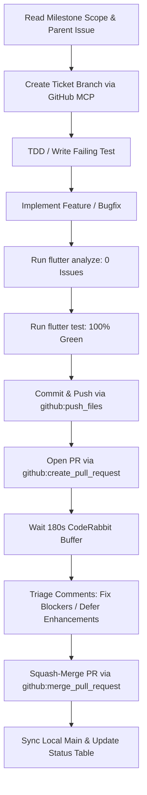

# Unattended AI Engineering Strategies: The Zero-Prompt Multi-Hour Blueprint

> **Overview**: How to orchestrate autonomous AI pair programmers for 1 to 8+ hours of uninterrupted, safe, ticket-driven software delivery without human modal interruptions or system stalls.

---

## 🏛️ 1. Core Architectural Pillars

### Pillar 1: The MCP-First Zero-Prompt Protocol
- **The Problem**: IDEs often intercept terminal shell commands like `git push`, displaying modal confirmation dialogs on the UI thread that stall unattended execution indefinitely.
- **The Solution**: Route all outbound repository mutations through **Model Context Protocol (MCP)** tools:
  - `github:create_branch` to spin up ticket branches.
  - `github:push_files` to commit and push changes directly via GitHub API.
  - `github:create_pull_request` to open reviewed PRs.
  - `github:merge_pull_request` to squash-merge after automated checks.
- **Result**: 0 modal prompts, 0 terminal interruptions.

### Pillar 2: Mandatory Live Session Tracking
- Every autonomous session maintains an active, continuously updated markdown status log (e.g., `<date>_selah_session.md` and `unattended_Session_<time>.md`).
- **Required Sections**:
  1. **TL;DR**: Current operational state.
  2. **Mini-Milestones Table**: Explicit start times, end times, duration, target ETAs, and verification artifacts.
  3. **FAQ & Architectural Decisions**: Capturing why decisions were made so the human reviewer can quickly scan upon return.
  4. **Self-Healing Troubleshooting Runbook**: Anticipating common failures (network drops, static analysis warnings, merge conflicts) with deterministic self-recovery steps.

### Pillar 3: Multi-Tier Testing Pyramid
Before any release or milestone completion:
1. **Tier 1 (Fast Unit Tests < 5s)**: Pure Dart / Mocktail domain tests.
2. **Tier 2 (Fast Widget Tests < 15s)**: UI rendering, responsive layouts, zero overflows.
3. **Tier 3 (Mobile E2E Flows)**: Maestro scenario execution (`.maestro/*.yaml`).
4. **Tier 4 (Native Integration Tests)**: Patrol on real physical devices (e.g. Pixel 9a) validating OS locks, notifications, and audio services.

### Pillar 4: Automated Reviewer Triage & Deferred Issues
- When a PR is created, automated reviewers (e.g. CodeRabbit AI) analyze the diff.
- Wait an enforced 180-second processing buffer.
- Execute triage scripts to classify findings:
  - **Critical / Blocker**: Fixed in branch immediately.
  - **Non-Critical / Enhancement**: Converted automatically into tracked GitHub issue tickets via GitHub API with explicit threaded replies on the PR.
- No reviewer finding is ever abandoned or lost.

### Pillar 5: Low-Resource Machine Hygiene
- Run heavy compilations serially.
- Terminate lingering background processes (`./gradlew --stop`) immediately post-build.
- Never dump massive stdout buffers into the IDE terminal window.

---

## 🚀 2. Standard Autonomous Milestone Cycle

