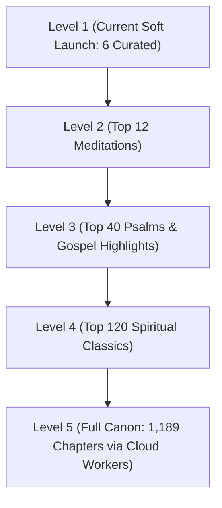

# WhisperX Progressive Alignment Plan & Passage Scaling Strategy

> **Date**: 12 October 2026  
> **Philosophy**: *Demand-Driven Progressive Alignment*.  
> Rather than attempting to pre-align all 1,189 Bible chapters (31,102 verses) upfront on resource-constrained hardware, Selah uses an intelligent progressive ladder: curated passages are pre-aligned with high-precision WhisperX timestamps, while unaligned passages gracefully fall back to full chapter audio / peaceful TTS and report demand telemetry to prioritize subsequent calibration batches.

---

## 🪜 The 5-Level Passage Alignment Ladder

### Level 1: Soft Launch Baseline (6 Curated Passages) — **100% Verified**
Pre-bundled with verified WhisperX acoustic silence alignment and human narrator audio (BSB, WEB):
1. **1 Corinthians 13:4–7** (Love is patient, love is kind)
2. **Matthew 11:28–30** (Come to me, all who are weary)
3. **Romans 8:31–39** (More than conquerors)
4. **Psalm 23:1–6** (The Lord is my Shepherd)
5. **Psalm 62:1–2** (My soul rests in God alone)
6. **Colossians 1:1–2** (Grace and peace)

---

### Level 2: Top 12 Meditations (Immediate Next Batch)
Targeting the most frequently searched contemplative verses:
7. **Psalm 91:1–4** (He who dwells in the shelter of the Most High)
8. **John 3:16–17** (For God so loved the world)
9. **Philippians 4:6–7** (Do not be anxious about anything)
10. **Proverbs 3:5–6** (Trust in the Lord with all your heart)
11. **Isaiah 40:28–31** (Those who wait upon the Lord shall renew their strength)
12. **Romans 12:1–2** (Present your bodies as a living sacrifice)

---

### Level 3: Top 40 Spiritual Havens (Gospels & Psalms)
- **Psalms of Comfort & Refuge**: Psalms 1, 16, 27, 34, 46, 84, 103, 121, 139.
- **Words of Jesus**:
  - The Beatitudes (Matthew 5:1–12)
  - The Lord's Prayer (Matthew 6:9–13)
  - The Light of the World (John 8:12)
  - The Good Shepherd (John 10:11–18)
  - The True Vine (John 15:1–8)
  - The Great Commission (Matthew 28:18–20)
- **Epistles & Wisdom**:
  - Galatians 5:22–23 (Fruit of the Spirit)
  - Ephesians 6:10–18 (Armor of God)
  - James 1:2–5 (Joy in Trials)
  - 1 Peter 5:6–7 (Cast your anxiety on Him)

---

### Level 4: Top 120 Curated Reflections
Expands to full key chapters across Pentateuch, Major Prophets, and New Testament Epistles.

---

### Level 5: Full Canon (1,189 Chapters / 31,102 Verses)
Automated cloud worker pipeline utilizing FCBH Bible Brain verse timestamps where available and serverless WhisperX GPU instances for missing books.

---

## 📡 Crowd-Sourced Telemetry & Feedback Reporting Loop

To guarantee that early testers never hit a dead end and that engineering always aligns what believers actually meditate on:

1. **Uncurated Verse Range Search**:
   - When a meditator searches a passage not yet pre-clipped (e.g. `col 1:17-20`), the app gracefully displays an informative SnackBar with a **"Request"** action button.
   - Tapping "Request" dispatches:
     - **Firebase Analytics Event**: `passage_alignment_requested` with `{'passage': query, 'translation': translation}`.
     - **Private GitHub Issue**: Logged to `njwandroid/selahfeedback/issues` labeled `passage-request` so Neil can calibrate narrator timestamps for that passage in the next batch.

2. **In-Player Audio Timing Feedback Bar (`PassageTimingFeedbackBar`)**:
   - A subtle, peaceful row right below the player card asking: *"Audio & timing peaceful?"*
   - **👍 Thumbs Up**: Logs positive confirmation telemetry (`passage_audio_timing_rated` with `rating: thumbs_up`).
   - **👎 Thumbs Down**: Opens a tranquil calibration sheet:
     - ☑️ *"Started too early or cut into words"*
     - ☑️ *"Cut off before verse finished"*
     - ☑️ *"Audio glitch or distortion"*
     - Automatically logs a structured issue to `njwandroid/selahfeedback/issues` labeled `audio-alignment`, specifying exact start/end offsets to calibrate in [Issue #95](https://github.com/neiljaywarner/selah_prototype_audio_13sep2026/issues/95).

---

## 🛠️ Python WhisperX Calibration Engine

Located in [scripts/verify_and_calibrate_timestamps.py](scripts/verify_and_calibrate_timestamps.py):
- Loads chapter audio MP3 and scripture text.
- Runs WhisperX acoustic alignment with word-level forced alignment.
- Calibrates start boundary by detecting leading acoustic silence (`FFmpeg silencedetect`).
- Emits calibrated JSON into `assets/timestamps/<translation>/<book>_<chapter>.json`.
